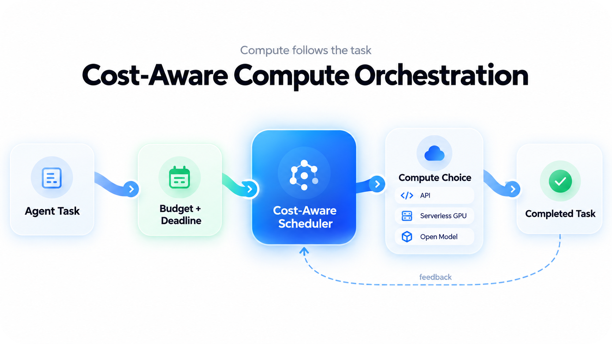

The cost of operating agentic systems depends on a decision that often receives less attention than model selection: how computing infrastructure is procured. Although access to language models has become progressively cheaper, many applications still use resources whose billing model does not match the way their agents work.

In a traditional application, infrastructure is typically sized to meet expected demand. Agentic systems behave differently. One task may require several inference calls, while another may spend most of its time waiting for an external response. This means that two agents with similar responsibilities can incur very different computing costs.

Cloud computing is already beginning to accommodate this difference. Providers offer GPUs billed by the second, shared resources, and mechanisms that shut down instances when there is no demand. At the same time, open-weight models such as DeepSeek V4 Flash 0731 show how advances in inference efficiency can reduce the cost of operating agents.

In this article, I examine how these changes could enable a different approach to computing in production. My proposal is that resource allocation become a decision made during the execution of each task, taking into account its cost and available deadline. This would allow agentic systems to choose not only which model to use, but also when to procure compute and how much to pay for it.

## The Task Should Determine the Purchase of Compute

Much of cloud infrastructure is still sold through the reservation of capacity for a period of time. A developer selects an instance, defines its resources, and pays for the availability of that infrastructure. This model works well when demand is relatively constant, but it can generate waste when an application uses its resources intermittently.

In agentic systems, the problem becomes more apparent because demand is not necessarily known before execution. One task may be completed after a single inference call, while another may require several attempts. When all of them use the same infrastructure, the system ends up treating different needs as though they were equivalent.

An alternative would be to use the task as the unit of purchase. Instead of reserving a fixed amount of compute in advance, the system would receive a budget and decide how to use it as the work progressed.

Consider a startup that uses agents to process financial documents. Some requests need to be completed immediately, but others can wait a few hours. In this scenario, the system could route urgent tasks to an inference API available at that moment and schedule the others for execution when the cost is lower.

This decision could also involve dedicated infrastructure. If a step required a specialized model, the orchestrator could request a serverless GPU only for the duration of its processing. Once the work was completed, the resource would be released. The choice between an API and a GPU would depend on the estimated cost of completing the task, rather than merely the price advertised by each provider.

This approach requires the orchestrator to maintain information about execution. It needs to know how much has already been spent and how much work remains. It also needs to recognize when the cost of switching infrastructure exceeds the expected savings. Without this control, pursuing the lowest inference price can increase the application's total cost.

Recent research already investigates part of this problem. The study [AgentRouter](https://arxiv.org/abs/2609.22951), published in September 2026, examines how to distribute steps in agentic systems among models with different costs. My proposal extends this decision to the infrastructure used for each step. Model selection would remain important, but it would become part of a decision about the execution cost of the entire task.

## Deadlines Also Determine the Cost of Inference

The price of a computational operation depends not only on the amount of resources consumed. It can also vary according to when those resources are used. This difference creates an opportunity for applications that do not need to complete every task immediately.

DeepSeek already offers a commercial example of this principle. With the launch of DeepSeek V4.1 Flash in September 2026, the company maintained a pricing policy that distinguishes peak and off-peak periods. According to its [pricing table](https://api-docs.deepseek.com/quick_start/pricing/), generating one million tokens costs $1.20 during peak hours and $0.60 outside those hours.

The same model also has different input-token prices. Without a cache hit, one million tokens costs $0.30 during peak hours and $0.15 off-peak. This allows an application to halve its direct inference cost simply by changing when execution takes place, provided the task can wait.

To understand the impact, consider an application that processes 50,000 documents per day, using an average of 1,500 input tokens and 250 output tokens per document. At these volumes, the direct API cost would be approximately $37.50 if all processing occurred during peak hours. Outside that period, it would be $18.75. The calculation considers inference only, without caching or additional calls.

This example demonstrates savings that do not require changing the model or reducing the amount of information processed. The application continues performing the same work but uses the flexibility of its deadline to procure inference at a lower price.

The decision, however, needs to account for the time available. If a task is approaching its completion deadline, waiting for a lower rate could compromise the service. The orchestrator should use the discount only when it can preserve the deadline agreed upon with the customer.

This relationship between time and price also appears in the research [Pricing Time, Not Just Tokens](https://arxiv.org/abs/2609.40098), published in September 2026. The study examines how latency tolerance can influence inference pricing. For agentic systems, this idea can be applied directly to task scheduling.

An agent that receives work throughout the day does not necessarily need to execute it in the same order in which it was received. Some demand can be organized according to deadlines, allowing the application to take advantage of lower-cost periods without changing the experience expected by the customer.

## What Granular Compute Already Makes Possible Today

The infrastructure needed for this model is beginning to appear in cloud services, although important differences remain between sharing a GPU, renting an instance by the second, and paying only for processing actually performed.

In July 2025, AWS [announced](https://aws.amazon.com/about-aws/whats-new/2025/07/amazon-ec2-g6f-instances-fractional-gpus/) the general availability of EC2 G6f instances. They allow customers to rent fractions of an NVIDIA L4, including configurations equivalent to one-eighth of the GPU. This partitioning reduces the minimum amount of hardware required to run certain applications, although billing remains tied to the rented instance.

Google Cloud took a different approach. Since June 2025, [Cloud Run has offered GPUs](https://cloud.google.com/blog/products/serverless/cloud-run-gpus-are-now-generally-available) with per-second billing and automatic scaling down to zero instances. This makes it possible to run models without keeping a GPU permanently available when there are no requests.

RunPod also sells serverless inference with per-second billing. Its [documentation](https://github.com/runpod/docs/blob/main/serverless/pricing.mdx) clarifies, however, that billing begins when the worker starts and ends when it shuts down. Startup time and the period during which the worker remains active after a request are also billed.

This distinction matters because the cost of executing a task does not necessarily correspond to the time the GPU spends performing calculations. A short operation may require loading a model before it can begin. If the system creates a worker for each request, startup may account for a considerable portion of the expense.

Today's granular compute therefore already makes it possible to reduce idle periods and procure resources for shorter intervals. But it does not yet universally provide a market in which any application can purchase only the amount of processing needed for an operation, regardless of the hardware used.

Open-weight models expand the possibilities of this infrastructure. [DeepSeek V4 Flash 0731](https://huggingface.co/deepseek-ai/DeepSeek-V4-Flash-0731), released under the MIT license, allows independent operators to offer inference services without relying exclusively on proprietary models. Deploying it, however, requires memory capacity compatible with the model's size, which can make an API more economical for low-volume applications.

In September 2026, DeepSeek replaced V4 Flash with V4.1 Flash in its official API. The old identifiers began routing requests to the new model, while the V4 Flash 0731 weights remain available. This is an example of why cost comparisons must consider the version actually being used and the infrastructure required to serve it.

As providers expand sharing capabilities, it will become possible to develop services that offer progressively smaller units of compute. This could reduce the minimum cost of using specialized models and allow low-demand applications to access accelerators that today are primarily rented by organizations with greater financial capacity.

## How Agents Could Decide Where to Execute Each Task

To turn these capabilities into savings, an application would need a layer responsible for procuring compute. This layer would operate between the agent and the providers, receiving requests and deciding how to fulfill them.

The decision would begin with the expected cost of completion. An API may have the lowest price per token and still become more expensive when a task requires several attempts. Likewise, a GPU with a lower hourly rate may be a worse choice if it remains active for much of the processing period without receiving work.

The system would need to consider execution history before selecting a resource. If a particular class of tasks is usually completed with a lower-cost model, that model could be prioritized. When there is evidence that it does not achieve the expected result, the application could use another resource, respecting the available budget.

This would allow selection to stop depending on fixed rules for each agent. The decision would be informed by the application's observed behavior and the prices available at execution time.

It would also be necessary to preserve the company's control over these choices. An agent should not procure resources without spending limits or send information to an unauthorized provider. The execution layer would need to operate within the permissions established by the application.

My proposal does not require an LLM to directly control all the infrastructure. Many decisions can be made by a scheduler that uses information about costs and availability. The language model would remain responsible for the steps that require its reasoning, while the execution system would determine how to procure the resources.

To verify the benefit of this approach, I consider it important to compare the cost of completed tasks, rather than inference expenses alone. The comparison should preserve the same set of tasks and require results of equivalent quality. This would make it possible to identify whether savings come from better resource allocation or simply from a reduction in the work performed.

It would also be important to measure how much the application spends while waiting for resources and how much it costs to recover interrupted tasks. These values determine whether a serverless service is actually more economical than a dedicated instance at a given demand volume.

Combining this information would allow the orchestrator to decide when switching providers is worthwhile. A small saving on the advertised rate can disappear when transferring a task requires additional time. The objective should be to minimize the expense required to deliver the result while meeting the established deadline.

## What This Means for Your Business

The potential impact of this change is especially relevant for startups developing agent-based products. During their early stages of operation, these companies often need to provide continuous availability without having enough demand to keep dedicated infrastructure in constant use.

Access to efficient models through APIs already reduces part of this difficulty. Granular compute can extend this benefit by allowing a company to procure additional capacity only when the workload justifies the expense.

This also changes how a startup can evaluate its margins. Instead of treating AI infrastructure primarily as an expense associated with installed capacity, it would be possible to track how much it costs to complete a task for each customer. This information would allow computational consumption to be directly linked to the revenue generated by the product.

For companies with higher volumes, the opportunity lies in distributing demand. An operation that uses resources continuously may benefit from procuring dedicated capacity. But some of its tasks can still be routed to services with different prices, provided the savings offset the cost of moving the work.

The development of compute markets could expand these options. If independent providers can offer capacity through compatible interfaces, a system will be able to compare offers without requiring each application to be developed specifically for a single platform.

Obstacles to this vision still exist. GPU availability varies by region, moving data incurs costs, and some applications cannot use just any provider. These factors limit the orchestrator's freedom and must be part of its decisions.

There is also no guarantee that compute will become continuously cheaper. Increased efficiency can reduce processing costs, while growing demand keeps some infrastructure in high demand. For this reason, I consider it more important to develop systems capable of taking advantage of price differences than to depend on a uniform decline in rates.

The main change I foresee is a shift from infrastructure selected in advance by the developer to infrastructure procured according to the needs of each execution.

In this model, agents would continue using LLMs through APIs and open models. The difference would lie in their ability to decide how much to spend and when to execute the work. Compute would cease to be merely a resource available to the agent and would become part of its execution decisions.

For startups, this could mean products that grow without requiring proportional upfront investments in infrastructure. For established companies, it could allow a greater share of AI spending to be tied to the work delivered.

Granular compute already offers some of the mechanisms needed for this change. The next step is to develop systems capable of using these mechanisms according to the conditions of each task.

This is where I see an opportunity for the next generation of agentic infrastructure. Progress will depend not only on cheaper models or GPUs with lower rates, but on the ability to procure compute according to the value and deadline of the work that needs to be performed.

*Partnerships and projects:* contact@antoniovfranco.com